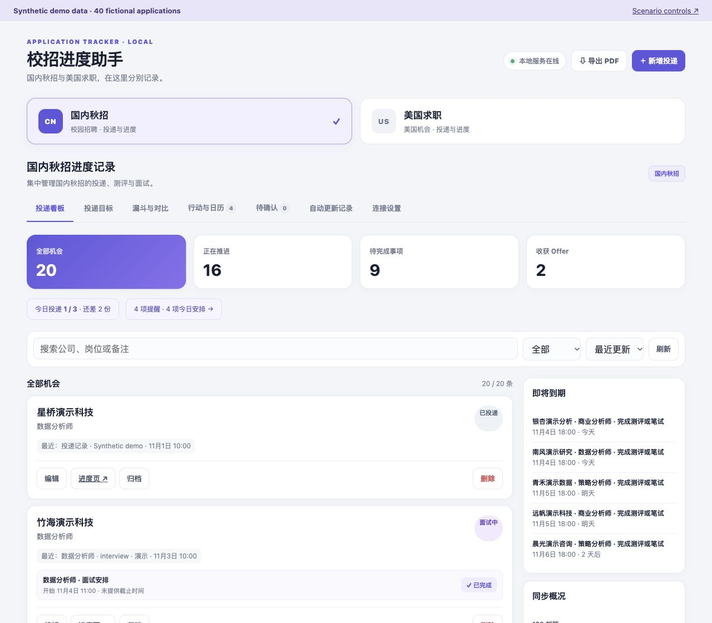
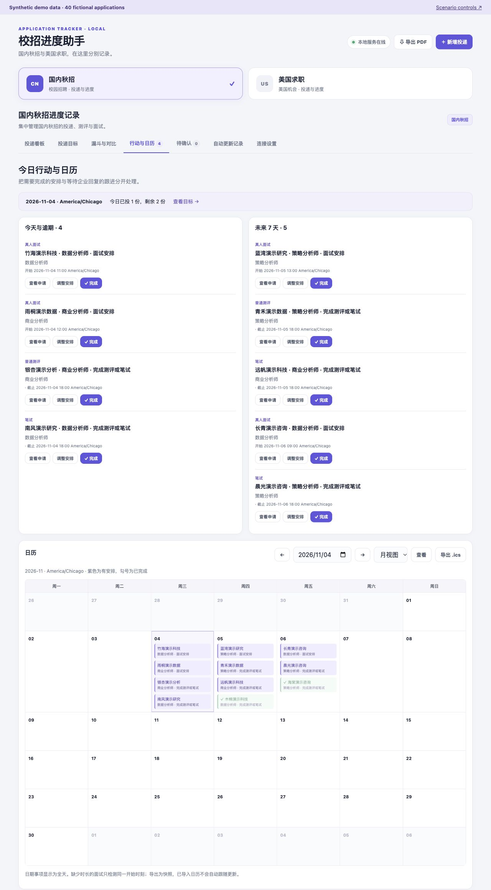
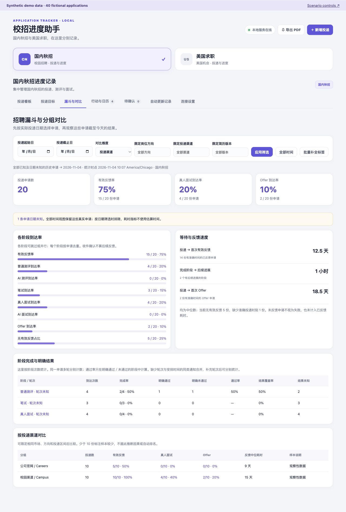

# Campus Recruitment Assistant

English | [简体中文](README.zh-CN.md)

A local-first assistant for planning, tracking, and reviewing job applications.

**Built with Vibe Coding**

## What it does

- **Plan and record:** Set daily/weekly goals; keep structured applications, stage timestamps, and direct application/status links together.
- **Notifications into actions:** Associate 126 Mail and browser updates with applications, then create assessment, written-test, and interview to-dos.
- **Follow up and review:** Track deadlines and calendars; explore application cohorts, channels, résumé versions, and feedback timelines.

## Demo



_Synthetic demo data. All employers, applications, and outcomes shown are fictional._

<details>
<summary>View action-calendar and retrospective-analysis screenshots</summary>

**Upcoming actions and calendar — synthetic demo data**



**Cohorts, denominators, and channel comparisons — synthetic demo data**



</details>

Explore 40 fictional applications across China and U.S. workspaces. Scenario controls process an assessment notification, replay it without duplicates, or create an ambiguous match for review. Refresh the dashboard after each scenario; records and tasks use the existing application pipeline.

## Quick start

Requires Node.js 22.13+ within 22.x, or 24.x, and npm.

```bash
npm ci
npm run demo
```

Open [the dashboard](http://127.0.0.1:43112) and [scenario controls](http://127.0.0.1:43112/demo). The command builds the app, creates temporary SQLite data, and deletes it when stopped with Ctrl+C. It does not load personal records or credentials; email operations and desktop notifications are disabled. Restart to reset. Port 43112 must be available.

## Quality and boundaries

[](https://github.com/ringing-0619/campus-recruitment-assistant/actions/workflows/ci.yml)

- **377 regression tests:** Includes duplicate processing, ambiguous review, market isolation, analytics expectations, and demo cleanup.
- Real use supports 126 IMAP and Chrome/Edge; full desktop integrations require macOS. The interface is primarily Chinese.
- Screenshots and test fixtures demonstrate behavior; they do not establish recognition accuracy or improvements in recruiting outcomes.

## Further reading

[User guide](docs/user-guide.en.md) · [Case study](docs/case-study.md) · [Architecture](docs/architecture.md) · [License](LICENSE)
