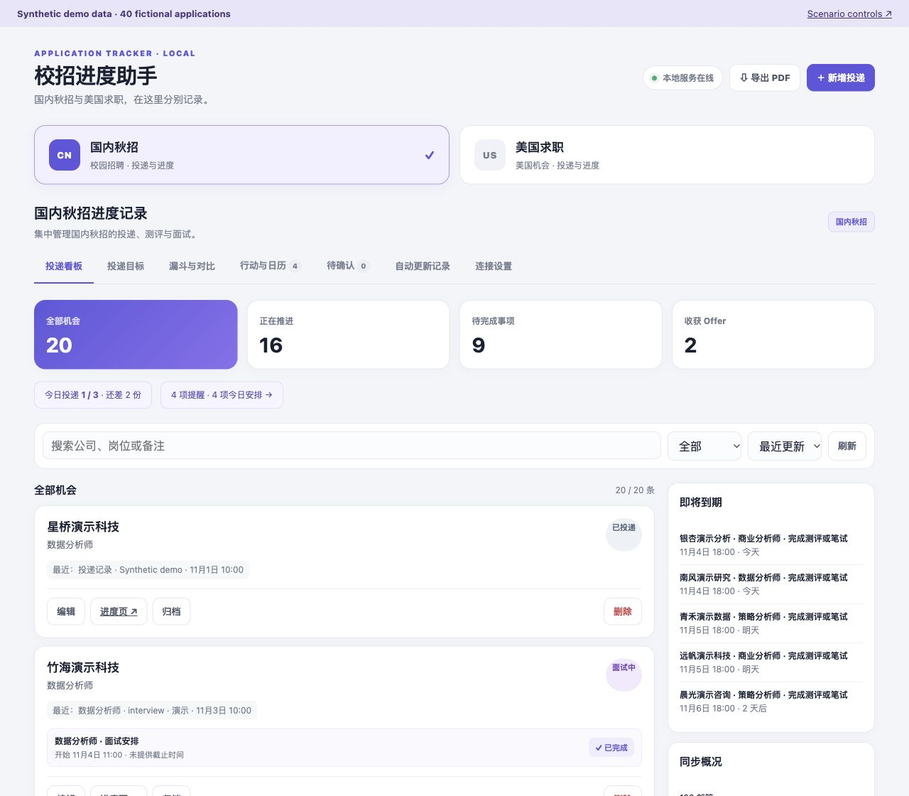
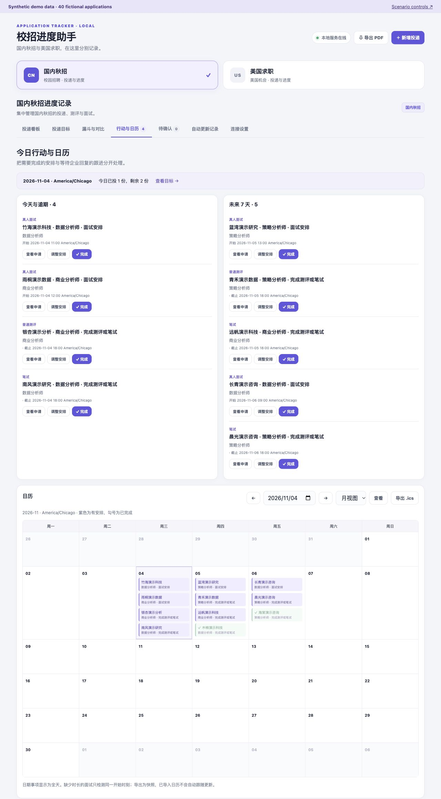
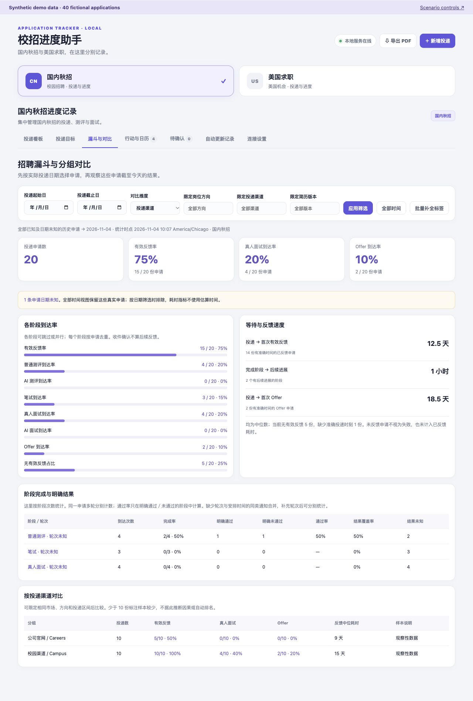

# 校招进度助手

[English](README.md) | 简体中文

用于计划投递、跟进进展与复盘求职过程的本地助手。

**开发方式：Vibe Coding**

## 核心价值

- **计划与记录**：管理日／周投递目标，集中记录申请信息、阶段时间及投递页面链接。
- **通知与行动**：整合 126 邮件与网页更新，关联申请进展，生成测评、笔试和面试待办。
- **跟进与复盘**：通过行动日历、进度追踪、投递漏斗和渠道对比，支持持续跟进与阶段复盘。

## 模拟演示



_所有公司、申请和结果均为虚构演示数据。_

<details>
<summary>展开查看行动日历与复盘分析</summary>

**行动与日历 · Synthetic demo data**



**投递漏斗与渠道对比 · Synthetic demo data**



</details>

演示包含国内、美国各 20 条虚构申请。控制页可模拟测评通知、重复处理同一通知，或触发需要人工确认的歧义匹配。处理后刷新看板，即可查看由实际业务流程生成的记录与待办。

## 快速体验

需要 Node.js 22.13+ 的 22.x 或 24.x，以及 npm。

```bash
npm ci
npm run demo
```

打开[演示看板](http://127.0.0.1:43112)与[场景控制页](http://127.0.0.1:43112/demo)。命令自动构建，使用独立临时数据库，Ctrl+C 退出后清理；重新启动恢复初始场景。端口 43112 需要空闲。演示不读取个人记录或凭据，并禁用真实邮箱操作和系统通知。

## 验证与边界

[](https://github.com/ringing-0619/campus-recruitment-assistant/actions/workflows/ci.yml)

- **377 项回归测试**：覆盖重复处理、歧义确认、模块隔离、分析预期与演示清理。
- 日常使用支持 126 IMAP 与 Chrome／Edge，完整桌面集成需要 macOS；界面主要使用中文。
- 截图与测试样本用于验证功能，不代表识别准确率或实际求职效果提升。

## 进一步阅读

[使用指南](docs/user-guide.md) · [英文详细指南](docs/user-guide.en.md) · [案例说明](docs/case-study.md) · [架构](docs/architecture.md) · [许可](LICENSE)
