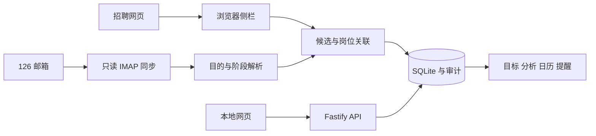

# 架构与数据流

## 模块

| 目录或模块                                               | 职责                                |
| -------------------------------------------------------- | ----------------------------------- |
| `src/server/app.ts`、`api.ts`                            | 服务创建、CORS、API 与静态页面      |
| `db.ts`、`productivity-schema.ts`                        | 数据库、兼容迁移、备份和审计撤销    |
| `mail.ts`                                                | 增量游标、只读 IMAP、回溯与失败重试 |
| `parser.ts`、`candidate-fields.ts`                       | 邮件目的、当前阶段和字段有效性      |
| `company-identity.ts`、`email-matching.ts`               | 公司别名、完整岗位、编号与会话关联  |
| `candidates.ts`                                          | 自动采纳、事务、待办与阶段保护      |
| `goals.ts`、`analytics.ts`、`actions.ts`、`reminders.ts` | 目标、分析、行动及通知              |
| `src/shared/`                                            | 模块标记、类型与时区工具            |
| `src/web/`                                               | 本地页面、交互、导出与样式          |
| `extension/`                                             | 侧栏、网站授权、采集、暂存和监控    |

## 关键约束

- `market` 标记国内或美国；接口检查实体所属模块，匹配不会跨模块合并。
- 邮件 `sourceRef` 来自 Message-ID；美国使用独立命名空间。网页按可靠申请编号及岗位生成去重键。
- 公司身份先确定范围，再关联岗位。角色、编号、地区或会话冲突时停止自动写入。
- 解析分与匹配分分别表达不同证据，弱解析不能仅靠高匹配分获得自动采纳。
- 岗位、事件、待办和候选处理状态在嵌套安全事务中写入；审计记录可撤销。
- 较旧通知只能补充历史，不能倒退较新的进度或重开已完成任务。

## 同步生命周期

启动后短暂延迟开始邮箱同步；未配置邮箱时只等待，不读取钥匙串。连接失败记录可读状态，并按退避间隔重试。

每封邮件成功处理后推进 UID；正文下载失败保留重试机会。规则版本变化时回溯最近 90 天，保留历史模块和已处理决定。每轮结束重新尝试尚未处理的候选，处理通知先于投递记录出现的顺序问题。

数据库默认仅在本机使用。完整邮件正文和回复头只在当次内存处理中使用，持久化只保留短证据摘要。凭据通过 macOS 钥匙串管理。
