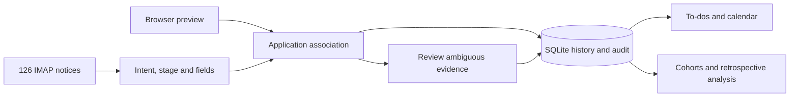

# From scattered updates to a traceable application history

This personal application was built with Vibe Coding to support a planned job search: maintain a consistent record, return directly to an application page, turn scattered notices into actions, and review the history later. The public demo uses independently invented records and outcomes.

## Data flow

## Linking evidence without overwriting history

The [parser](../src/server/parser.ts) classifies progress notices and extracts company, role, identifiers and explicit dates. The [matcher](../src/server/email-matching.ts) uses application IDs, related conversations and complete role evidence within the selected market. Parsing confidence and association confidence represent different evidence; a 0.9 auto-apply threshold is a rule setting, not a measured accuracy score.

The [candidate service](../src/server/candidates.ts) applies accepted updates transactionally, creates stage events and actionable tasks, and records reversible changes. Stable source references make message replay idempotent. Older evidence can supplement history without rolling back newer stages. A company with multiple plausible roles requires an explicit selection.

Try the three controls at `/demo` after starting the local demo: the assessment creates one event and one deadline task; replay leaves their counts unchanged; the ambiguous notice stays pending until a role is selected. These cases exercise existing domain logic rather than a separate mock implementation.

## Defining useful retrospective metrics

The [analytics implementation](../src/server/analytics.ts) chooses cohorts by actual application date and carries each metric's numerator, denominator and contributing records. Application receipts do not count as subsequent recruiting feedback. Unknown dates remain visible in the all-time view but are excluded from bounded-date cohorts. Unknown outcomes do not count as failures; stage pass rates use only explicit passed/failed results.

Elapsed-time medians use records with known timestamps and report their sample sizes. Pending applications are not treated as completed failures. Channel and résumé-version comparisons are observational; small groups are flagged and no causal uplift is inferred.

## Reproducible evidence

The initial demo has 20 applications per market, including one unknown application date. Each market has 15 feedback-bearing applications and two offers, producing 15/20 feedback and 2/20 offer ratios in its all-time view. These values are deliberately constructed to verify calculations; they are not personal or customer outcomes.

[Demo tests](../tests/demo.test.ts) check these results, notification replay, manual review, blocked external operations, temporary-file cleanup, and inherited production-path isolation. Existing suites cover parser fixtures, browser extraction, transactions, undo, migrations, goals and calendar behavior. Use `npm run validate` to reproduce the current test count and build/smoke checks; use the workflow badge for the latest remote status.

## Boundaries

The demo does not log in to recruiting sites, access a real mailbox, read Keychain credentials or send desktop notifications. Its controls and fictional status pages exist only in the demo service. Normal production APIs and storage schema are retained. No user counts, time savings, recognition accuracy or recruiting improvements are claimed without a separate measured study.
